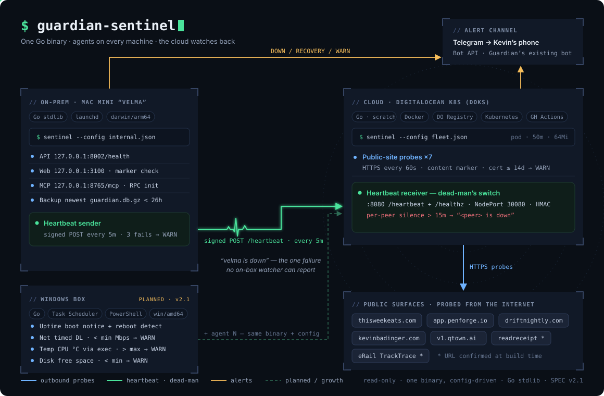

# guardian-sentinel

One small, dependency-free Go monitoring service, deployed twice:

- **On the box** (a Mac mini under launchd): watches my self-hosted AI memory
  system from the inside — API, web UI, MCP server, nightly-backup freshness.
- **In the cloud** (a 1-node DigitalOcean Kubernetes cluster): watches every
  live site I've shipped from the real internet — content checks, cert-expiry
  warnings — deployed via a registry + CI/CD rolling-update pipeline.

The two instances cover each other with a **dead-man's switch**: the on-prem
instance heartbeats the cloud one, so "the whole box is down" — the one failure
no on-box watcher can report — still pages my phone. All alerts via Telegram.

**Status: spec complete (v2), build not started.** The full build spec — probe
types, config schema, state machine, testing, both deployments, milestones — is
in [SPEC.md](SPEC.md).

- Go stdlib only, zero third-party dependencies; single static binary
- Config-driven probes (JSON): same binary, different config per deployment
- Read-only by design: it observes, it never touches what it watches
